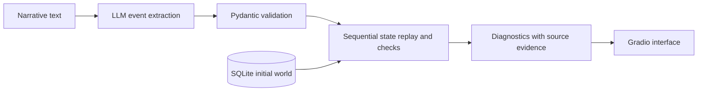

# Narrative Linter

A coursework prototype that combines LLM-based event extraction with deterministic narrative consistency checks against a SQLite world model.

**Course:** Large Language Model and Societal Consequence, Uppsala University.
**Project type:** Team project.
**My contribution — Junmo Cai:** Proposed the project idea, designed the system architecture, and implemented the prototype.

## Problem and approach

A language model can overlook contradictions between a narrative and established world facts. This prototype extracts discrete events and checks a limited set of invariants against explicit character, location, inventory, and rule data.



The application runs as **Python scripts**, not a Jupyter notebook. `python app.py` starts a local Gradio web service, normally at `http://127.0.0.1:7860`. The extractor connects separately to an OpenAI-compatible model endpoint, defaulting to LM Studio at `http://127.0.0.1:1234/v1`.

## Run

Tested locally with Python 3.13. Run the commands below from the repository root. Create a virtual environment there:

```bash
python -m venv .venv
source .venv/bin/activate
pip install -r requirements.txt
```

An offline example needs no model server:

```bash
python demo.py
python evaluate.py
python -m unittest discover -s eval -v
```

See [validation instructions and retained evaluation evidence](docs/VALIDATION.md)
for offline checks, live model evaluation, and manual demonstration steps.

For the interactive application, load your model in LM Studio and start its local server. Set the exact model ID exposed by that server:

```bash
export NARRATIVE_LINTER_MODEL="your-local-model-id"
python app.py
```

`NARRATIVE_LINTER_BASE_URL` and `NARRATIVE_LINTER_API_KEY` override the provider configuration. The original default model string is `qwen/qwen3.5-9b`; availability depends on the local server. SQLite is initialized on startup. Each audit replays events in memory, leaving the initial database unchanged.

Code that calls the storage, verifier, or world-import helpers directly must call
`initialize_database(database_path)` once before accessing the database. Use
`seed=False` for an empty world. The application, offline scripts, and test setup
already initialize their databases explicitly; ordinary access does not repeat
schema migrations or demo initialization.

## Example

```text
Hero gave Guard a magic wand.
Guard used the magic wand.
```

The seeded world contains no magic wand. The prepared version reports an inventory deficit on both lines: an invalid transfer does not create an item in the receiver's inventory.

The dashboard exposes the extracted events alongside diagnostics. Empty extraction is `NOT CHECKED`, unsupported events produce warnings, and `CHECKS CLEAR` means only that no implemented invariant was violated by the extracted events.

## Evidence and limits

The original repository contained 14 unit tests. The pre-import preparation passed 28 tests and 17 manually specified synthetic acceptance cases. World-state extraction adds dedicated migration, extraction, merge, confirmation, and interface callback tests. These cases bypass the LLM using gold event records; they do **not** measure real extraction quality or performance on a held-out narrative benchmark. That earlier preparation did not include live model evaluation. The separate world-state extraction evaluation below now records real LM Studio results.

The prototype supports a finite action vocabulary, name-based entity matching, exact location checks, item names without quantities, and keyword rules. It does not fully handle aliases, pronouns, negation, flashbacks, simultaneous events, travel constraints, or unreliable narrators. Source-span validation checks traceability, not semantic entailment. End-to-end comparison with an LLM-only baseline remains future work.

## Coursework versus preparation

The [original coursework snapshot](https://github.com/cai7874/narrative-linter/tree/4917c6b4bf88c66c252cdc049a19311203a1a7dd) is preserved in Git history. This version adds portfolio-time bug fixes, regression tests, offline examples, and clearer documentation with Codex assistance. These additions must not be presented as results completed during the original course project. See [preparation notes](docs/PREPARATION.md).

## World State Extraction

The application now has two tabs sharing one world database. In **World State
Extraction**, paste background notes, extract proposals, review/edit each fact and
its source evidence, select the candidates to accept, and explicitly confirm any
new character names. **Preview selected changes** shows additions, updates,
conflicts, unchanged facts, and skipped proposals. **Confirm and Save** commits the
reviewed selection and its provenance together. Editing inputs invalidates the
preview. A concurrent world edit requires a fresh preview; repeated confirmation
cannot duplicate an import. Cancellation and extraction failures never save facts.

The separate **Story Consistency Check** tab reads those saved facts and replays
supported events in memory. It does not persist a chapter's outcomes.

Unknown status, location, and inventory remain unknown. `null` inventory differs
from the known empty inventory `[]`. A possession statement adds a known item
without claiming the rest of an unknown inventory is empty. Missing ownership in
such a partial inventory produces an insufficient-information warning, rather
than a definite inventory deficit. Inventory proposals explicitly add, remove,
replace, or transfer items in source order. Null proposal values leave established
fields untouched. Uncertain, negated, and unresolved proposals remain blocked
until a person resolves or rejects them. New entities start with unknown fields.

Locations and relationships have stable IDs. Attributes, relationships, and
imported descriptive rules are stored and displayed; arbitrary prose rules do
not automatically become verifier checks. Existing compatible keyword rules
remain enforceable. The inspector shows import timestamps, original source text,
source lines, and before/after records. SQLite migrations preserve existing IDs
and facts, and deleted demo data is not reinserted on every startup.

Run the complete import/review example without a model or browser:

```bash
python demo_world_import.py
python -m unittest discover -s eval -v
```

Run the small, opt-in live extraction evaluation directly against LM Studio:

```bash
python -m eval.live_world_extraction --run
```

The six manually annotated examples assess explicit settings, transfers, omitted
facts, negation, ambiguous references, and contradictions. Reports in
`reports/world_live_evaluation.json` distinguish schema/evidence failures from
semantic extraction errors and list suggested human corrections. They do not
measure a representative benchmark or establish semantic correctness of every
proposal. The model can omit or misinterpret facts despite valid JSON; human
review and confirmation remain necessary. The evaluator does not write SQLite.
