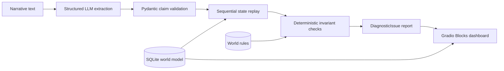

# Narrative Linter

Narrative Linter is a neuro-symbolic narrative consistency auditing engine.
It combines LLM-based claim extraction with deterministic verification against
an external SQLite world model.

## Architecture



The audit pipeline is intentionally split into probabilistic and deterministic
stages:

1. The OpenAI-compatible model extracts action claims, entities, items, and
   claimed locations from the narrative.
2. Pydantic validates the strict JSON response.
3. The verifier replays claims in input order against an in-memory copy of the
   SQLite state.
4. Deterministic checks evaluate status, inventory, spatial co-presence, world
   rules, and unknown entities.
5. The dashboard presents compiler-style diagnostics with line numbers and
   database evidence.

The SQLite seed is never modified by an audit. Replay state is scoped to the
current request.

The application uses an OpenAI-compatible endpoint. By default it connects to
LM Studio at `http://127.0.0.1:1234/v1` and requests the
`qwen/qwen3.5-9b` model.

## LM Studio setup

1. Load `qwen/qwen3.5-9b` in LM Studio.
2. Start the local server on port `1234`.
3. Start the application:

```bash
cd /Users/cai/Desktop/checker
.venv/bin/python app.py
```

The default API key is the placeholder `lm-studio`, so no environment
variables are required for the default LM Studio setup.

## Custom provider or model

Override any default with environment variables:

```bash
export NARRATIVE_LINTER_API_KEY="provider-api-key"
export NARRATIVE_LINTER_BASE_URL="http://127.0.0.1:1234/v1"
export NARRATIVE_LINTER_MODEL="provider-model-id"
.venv/bin/python app.py
```

`OPENAI_API_KEY` and `OPENAI_BASE_URL` are also accepted as compatibility
aliases. `NARRATIVE_LINTER_*` variables take precedence.

## Audit behavior

The verifier replays extracted claims in input order against an in-memory copy
of the SQLite world state. It validates claimed locations, updates movement
destinations, and tracks item acquisition, transfer, dropping, and consumption.
Unknown subject and interaction-target entities are reported as
`ENTITY_NOT_FOUND`. The SQLite seed remains unchanged; replay is scoped to the
current audit.

## Limitations

This release is an MVP and should be treated as decision support rather than
an authoritative statement about narrative truth.

- The extractor depends on the selected LLM and can miss, merge, or
  misinterpret actions, entities, items, and locations.
- Entity resolution is currently case-insensitive name matching; aliases,
  pronouns, duplicate names, and ambiguous references are not resolved.
- Replay supports a finite set of normalized actions. It does not yet model
  historical timelines, flashbacks, dreams, hypothetical statements, or
  unreliable narrators.
- Movement updates the in-memory location directly and does not model travel
  time, reachability, nested locations, visibility, or distance.
- Inventory replay tracks item names but not quantities, item identity,
  durability, ownership history, or concurrent actions.
- Rule matching is deterministic keyword matching, not a complete semantic
  rule language.
- The current spatial model requires exact location agreement and does not
  represent regions, adjacency, line of sight, or containment.
- Diagnostic quality depends on the quality of the database state and rules.
  Missing world knowledge can produce false positives or false negatives.
- The application currently runs as a local Gradio service and does not
  provide authentication, multi-user isolation, or persistent audit history.

These limitations define the next development areas: temporal event storage,
entity resolution, structured rule evaluation, richer spatial reasoning, and
evaluation against an annotated narrative benchmark.
