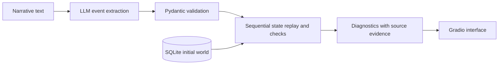

# Narrative Linter

A coursework prototype that combines LLM-based event extraction with deterministic narrative consistency checks against a SQLite world model.

**Course:** Large Language Model and Societal Consequence, Uppsala University.
**Project type:** Team project.
**My contribution — Junmo Cai:** Proposed the project idea, designed the system architecture, and implemented the prototype.

## Problem and approach

A language model can overlook contradictions between a narrative and established world facts. This prototype extracts discrete events and checks a limited set of invariants against explicit character, location, inventory, and rule data.



The application runs as **Python scripts**, not a Jupyter notebook. `python app.py` starts a local Gradio web service, normally at `http://127.0.0.1:7860`. The extractor connects separately to an OpenAI-compatible model endpoint, defaulting to LM Studio at `http://127.0.0.1:1234/v1`.

## Run

Tested locally with Python 3.13. Create a virtual environment from this repository directory:

```bash
python -m venv .venv
source .venv/bin/activate
pip install -r requirements.txt
```

An offline example needs no model server:

```bash
python demo.py
python evaluate.py
python -m unittest discover -s eval -v
```

For the interactive application, load your model in LM Studio and start its local server. Set the exact model ID exposed by that server:

```bash
export NARRATIVE_LINTER_MODEL="your-local-model-id"
python app.py
```

`NARRATIVE_LINTER_BASE_URL` and `NARRATIVE_LINTER_API_KEY` override the provider configuration. The original default model string is `qwen/qwen3.5-9b`; availability depends on the local server. SQLite is initialized on startup. Each audit replays events in memory, leaving the initial database unchanged.

## Example

```text
Hero gave Guard a magic wand.
Guard used the magic wand.
```

The seeded world contains no magic wand. The prepared version reports an inventory deficit on both lines: an invalid transfer does not create an item in the receiver's inventory.

The dashboard exposes the extracted events alongside diagnostics. Empty extraction is `NOT CHECKED`, unsupported events produce warnings, and `CHECKS CLEAR` means only that no implemented invariant was violated by the extracted events.

## Evidence and limits

The original repository contained 14 unit tests. This prepared copy passes 28 tests and 17 manually specified synthetic acceptance cases. These cases bypass the LLM using gold event records; they do **not** measure real extraction quality or performance on a held-out narrative benchmark. No new live model evaluation was performed during preparation.

The prototype supports a finite action vocabulary, name-based entity matching, exact location checks, item names without quantities, and keyword rules. It does not fully handle aliases, pronouns, negation, flashbacks, simultaneous events, travel constraints, or unreliable narrators. Source-span validation checks traceability, not semantic entailment. End-to-end comparison with an LLM-only baseline remains future work.

## Coursework versus preparation

The [original coursework snapshot](https://github.com/cai7874/narrative-linter/tree/4917c6b4bf88c66c252cdc049a19311203a1a7dd) is preserved in Git history. This version adds portfolio-time bug fixes, regression tests, offline examples, and clearer documentation with Codex assistance. These additions must not be presented as results completed during the original course project. See [preparation notes](docs/PREPARATION.md).
